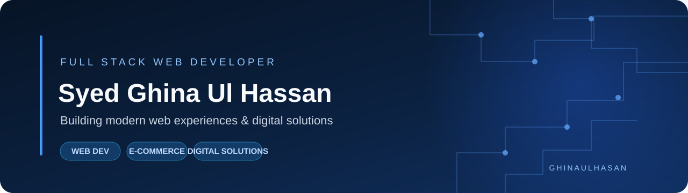

<!-- Premium Dark Blue GitHub Profile README -->

  

<h1 align="center">Hi, I'm Syed Ghina Ul Hassan 👋</h1>
<h3 align="center">Full Stack Web Developer &amp; Digital Solutions Specialist</h3>

  
  
  

---

## 👨‍💻 About Me

I'm a developer focused on building responsive websites, practical web applications, and digital solutions for businesses. I enjoy turning ideas into clean, user-friendly experiences and continuously improving my skills through hands-on projects. I'm open to **freelance projects, remote opportunities, internships, and full-time roles** where I can contribute and grow.

- 🌐 Interested in **Full Stack Web Development, E-Commerce, and Digital Solutions**
- 🧩 Building business websites, web applications, dashboards, and management systems
- 📚 Currently learning and exploring **Flutter & Dart** alongside modern web technologies
- 🤝 Founder & Leader at **Fyrelanes** | Chief Business Officer at **DevnexHub**
- 💼 Open to freelance collaborations, remote roles, internships, and full-time opportunities
- 🛠️ Services: responsive websites, front-end development, e-commerce interfaces, and business web solutions
- 🎯 Focused on clean UI, responsive layouts, maintainable code, and useful products

## 🛠️ Technologies & Tools

  

## 🚀 Featured Projects

| Project | Description | Tech / Focus |
|---|---|---|
| [Flutter Product Shop App](https://github.com/ghinaulhasan/flutter-app-project-batch-10c-product-cards) | Product-card shopping app built while learning Flutter | Flutter, Dart |
| [Web Portfolio](https://github.com/ghinaulhasan/web-portfolio-personal) | Personal portfolio website | HTML, CSS, JavaScript, Bootstrap |
| [E-Commerce Website](https://github.com/ghinaulhasan/E-commerece-web) | E-commerce web project | Frontend Development |
| [Pharmacy Software](https://github.com/ghinaulhasan/Pharmacy-software) | Pharmacy management software project | Software Development |
| [Inventory Form](https://github.com/ghinaulhasan/Inventory-Form) | Inventory-related application project | Web / Software |
| [College Fee Voucher System](https://github.com/ghinaulhasan/College-Fee-Voucher-System) | College fee voucher management project | Software Development |

## 📊 GitHub Overview

  
  

  

## 📫 Let's Connect

- **Email:** [syedghina@gmail.com](mailto:syedghina@gmail.com)
- **GitHub:** [@ghinaulhasan](https://github.com/ghinaulhasan)
- **Portfolio project:** [View repository](https://github.com/ghinaulhasan/web-portfolio-personal)
- **Blog:** [syedghinaulhasan.blogspot.com](https://syedghinaulhasan.blogspot.com/)

---

  <i>“Keep learning, keep building, and turn ideas into solutions.”</i>

  

